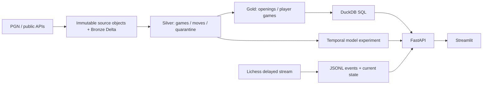

# chess4f

**Traceable chess analytics, from PGN to a Delta lakehouse and player insights.**

chess4f is a university/portfolio project that extends a chess-opening visualization study into a data application. It ingests public game data, recognizes openings by board position, serves player profiles and records reproducible pipeline runs.

> **Status: working local v0.1, not a finished distributed platform.** Delta Lake and DuckDB are implemented. Object storage, Spark, Trino/catalog and scheduled orchestration remain integration milestones; see [roadmap](docs/ROADMAP.md). The project does not claim these services are already deployed.

## What works

- PGN ingestion into Bronze/Silver/Gold Delta tables; original PGN objects retained by SHA-256.
- Source-scoped stable game IDs, repeatable upserts, correction of obsolete move tails, quarantine and run manifests.
- Opening recognition using legal board positions, a versioned Lichess catalog and the last match in the first 36 plies.
- Public Chess.com monthly player archives and a bounded Lichess archive extractor.
- SQL analytics through DuckDB reading only active files from committed Delta snapshots.
- Player results, openings, opponents, game replay and personal move frequencies with an explicit historical cutoff.
- Experimental **pre-game** logistic-regression W/D/L baseline using Elo, chronological evaluation and a prior-frequency baseline.
- Lichess public delayed stream receiver, raw event journal and observer UI. Not a Board API client, engine or player-assistance tool.
- FastAPI, Streamlit, Docker Compose and automated tests.

## Demo data and honest scope

Validated on 29 October 2026 with:

| Source | Scope | Games |
|---|---|---:|
| Lichess | First 1,000 matching Rated Blitz games on 2026-09-01 from the monthly archive | 1,000 |
| Chess.com | Public `hikaru` archive for September 2026 | 509 |

The Lichess demo is a **bounded integration sample**, not a random or representative monthly sample. The Chess.com sample is one player's history, not platform-wide data. Sources are selectable and not silently pooled. Data, models, credentials and virtual environments are excluded from Git.

## Architecture: current release



Storage is local on drive D for this milestone. The live journal is not yet automatically compacted into Delta or imported as a finished PGN; this is tracked in the roadmap.

## Run locally (Windows, Python 3.11)

From the repository root:

```powershell
python -m venv .venv
.\.venv\Scripts\python.exe -m pip install -e '.[dev]'
$env:CHESS4F_DATA = "$PWD/data"
.\.venv\Scripts\chess4f.exe catalog
.\.venv\Scripts\chess4f.exe fetch-day 2026-09-01 --limit 1000
.\.venv\Scripts\chess4f.exe sync-player hikaru --month 2026-09
```

The monthly archive is large even when selecting one day. The extractor streams it and stops at the requested cap; it does not download the entire compressed month first. Rerun analysis from the saved PGN to avoid repeated source traffic.

Start API and UI in two terminals:

```powershell
.\.venv\Scripts\python.exe -m uvicorn chess4f.api:app --host 127.0.0.1 --port 8000
```

```powershell
.\.venv\Scripts\python.exe -m streamlit run apps/dashboard.py --server.address=127.0.0.1 --server.port=8501 --server.headless=true
```

- Dashboard: http://localhost:8501
- API docs: http://localhost:8000/docs
- API is read-only and local-first. Do not expose directly to the internet: authentication and resource controls are not implemented yet.

## Docker

```powershell
docker compose up --build -d api dashboard
docker compose --profile jobs run --rm pipeline catalog
docker compose --profile jobs run --rm pipeline status
docker compose down
```

Do not run the native and Docker servers on the same ports simultaneously. `./data:/data` keeps project data beside the checkout. Docker images still live in Docker Desktop's own disk image; changing checkout location does not relocate that disk image.

## Useful commands

```powershell
# Read a saved PGN; re-import must not duplicate games.
chess4f ingest path/to/games.pgn --source lichess --start 2026-09-01 --end 2026-09-01

# Calendar plan ends at the last complete calendar month; availability is checked on fetch.
chess4f plan --start 2026-01

# Bounded backfill integration run: never marks a limited source scan as complete.
chess4f sync-months --start 2026-09 --end 2026-09 --limit 1000

# Full scan is opt-in and can consume many GB/time. Not executed by the quickstart.
# chess4f sync-months --start 2026-09 --end 2026-09 --all

chess4f train --source chesscom --speed blitz
chess4f live PUBLIC_LICHESS_GAME_ID --max-events 5
pytest -q
```

`sync-months` is currently a sequential CLI runner, **not an installed scheduler**. Its registry tracks completion of one source-file scan. UTC-month boundary spillover into adjacent source files remains a coverage issue; it must not be described as complete UTC-month coverage.

## Reading predictions

- **Move habits:** historical frequencies at the same legal position, restricted to the requested platform/player and games before the cutoff. Small counts are flagged. This is not a best-move recommendation or calibrated probability.
- **Outcome baseline:** pre-game only, features are Elo difference and average Elo. No final opening label or future moves are used. One platform/time control per model; out-of-range ratings are rejected.
- Training artifact records temporal split, data versions, log loss and multiclass Brier against a class-prior baseline. A model trained on one elite player's games is not validated for ordinary players.
- **Live:** the public Lichess endpoint documents a three-move delay. Displayed state is the latest received state, not necessarily the actual current board. Observe games; do not use this app as outside assistance while playing.

## Repository guide

| Path | Purpose |
|---|---|
| `src/chess4f/` | Source connectors, Delta storage, pipeline, analytics, model, API, live receiver |
| `apps/dashboard.py` | Streamlit UI |
| `tests/` | Data integrity, platform IDs, temporal leakage and API tests; fixtures are synthetic |
| `docs/` | Architecture decisions, roadmap, data contracts and validation notes |
| `data/` (ignored) | Source objects, Delta tables, run manifests, reference data, live journals, models |

## Sources

- [Lichess database](https://database.lichess.org/) — source PGNs.
- [Lichess chess-openings](https://github.com/lichess-org/chess-openings) — CC0 opening reference, commit recorded at download.
- [Chess.com PubAPI](https://support.chess.com/en/articles/9650547-what-is-the-pubapi-and-how-do-i-use-it) — public player archives; caching means new results may not appear immediately.
- [Lichess API](https://lichess.org/api) — documented public delayed observation.

Independent student project; not affiliated with Chess.com or Lichess. Source/platform terms apply to data. No third-party logos, private tokens or raw player datasets are included in this repository.
