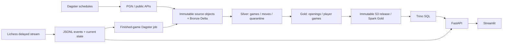

# chess4f

**Traceable chess analytics, from PGN to a Delta lakehouse and player insights.**

chess4f is a university/portfolio project that extends a chess-opening visualization study into a data application. It ingests public game data, recognizes openings by board position, serves player profiles and records reproducible pipeline runs.

> **Status: local application plus validated lakehouse batch integration.** MinIO, Spark, Hive Metastore and Trino have processed and verified a real-data release. Spark runs as one local driver (`local[2]`); this is not a multi-node cluster. Dagster schedules and a complete manual orchestration run are validated; username sync on both platforms and a real Lichess stream through finished-game publication are validated; unattended multi-day operation remains a milestone. See [Dagster orchestration](docs/ORCHESTRATION.md). See [lakehouse setup](docs/LAKEHOUSE.md), [validation evidence](docs/VALIDATION.md) and [roadmap](docs/ROADMAP.md).

## What works

- PGN ingestion into Bronze/Silver/Gold Delta tables; original PGN objects retained by SHA-256.
- Source-scoped stable game IDs, repeatable upserts, correction of obsolete move tails, quarantine and run manifests.
- Opening recognition using legal board positions, a versioned Lichess catalog and the last match in the first 36 plies.
- Public Chess.com monthly player archives and a bounded Lichess archive extractor.
- Trino-only application analytics pinned to a validated published release; DuckDB remains internal for transformation, training and reference checks.
- Dagster source checks and capped refresh schedules, with Spark validation before release publication.
- Player results, openings, opponents, game replay and personal move frequencies with an explicit historical cutoff.
- Background username-history synchronization and monthly backfill via a durable Dagster request queue, with progress and retry from the UI. The old model experiment is not exposed in the application.
- Lichess public delayed stream receiver, raw event journal and observer UI. Not a Board API client, engine or player-assistance tool.
- FastAPI, Streamlit, Docker Compose and automated tests.

## Demo data and honest scope

Demo sources (bounded samples; see validation notes for publication status):

| Source | Scope | Games |
|---|---|---:|
| Lichess | First 1,000 matching Rated Blitz games from each September and October 2026 archive | 2,000 |
| Chess.com | Public `hikaru` archive for September 2026 | 509 |

Validation added 10 October games for Lichess `german11`, 10 for Chess.com `hikaru`, and one completed observed Lichess game: **2,530 unique games** at this checkpoint.

The Lichess demo is a **bounded integration sample**, not a random or representative monthly sample. The Chess.com sample is one player's history, not platform-wide data. Sources are selectable and not silently pooled. Data, models, credentials and virtual environments are excluded from Git.

## Architecture: current release



Local Delta staging is published as immutable MinIO releases. Completed live games are automatically imported from PGN and published after Spark/Trino checks; raw event journals are retained by hash. See [user jobs and live workflow](docs/USER_JOBS.md).

## Run locally (Windows, Python 3.11)

From the repository root:

```powershell
python -m venv .venv
.\.venv\Scripts\python.exe -m pip install -e '.[dev]'
$env:CHESS4F_DATA = "$PWD/data"
.\.venv\Scripts\chess4f.exe catalog
.\.venv\Scripts\chess4f.exe fetch-day 2026-09-01 --limit 1000
.\.venv\Scripts\chess4f.exe sync-player hikaru --month 2026-09
```

The monthly archive is large even when selecting one day. The extractor streams it and stops at the requested cap; it does not download the entire compressed month first. Rerun analysis from the saved PGN to avoid repeated source traffic.

Start API and UI in two terminals:

```powershell
.\.venv\Scripts\python.exe -m uvicorn chess4f.api:app --host 127.0.0.1 --port 8000
```

```powershell
.\.venv\Scripts\python.exe -m streamlit run apps/dashboard.py --server.address=127.0.0.1 --server.port=8501 --server.headless=true
```

- Dashboard: http://localhost:8501
- API docs: http://localhost:8000/docs
- API includes local job-submission endpoints. Keep its localhost binding: public-user authentication is not implemented.

## Docker

```powershell
docker compose --env-file .env.lakehouse up --build -d api dashboard
docker compose --env-file .env.lakehouse --profile jobs run --rm pipeline catalog
docker compose --env-file .env.lakehouse --profile jobs run --rm pipeline status
docker compose --env-file .env.lakehouse down
```

Do not run the native and Docker servers on the same ports simultaneously. `./data:/data` keeps project data beside the checkout. Docker images still live in Docker Desktop's own disk image; changing checkout location does not relocate that disk image.

## Useful commands

```powershell
# Read a saved PGN; re-import must not duplicate games.
chess4f ingest path/to/games.pgn --source lichess --start 2026-09-01 --end 2026-09-01

# Calendar plan ends at the last complete calendar month; availability is checked on fetch.
chess4f plan --start 2026-01

# Bounded backfill integration run: never marks a limited source scan as complete.
chess4f sync-months --start 2026-09 --end 2026-09 --limit 1000

# Full scan is opt-in and can consume many GB/time. Not executed by the quickstart.
# chess4f sync-months --start 2026-09 --end 2026-09 --all

chess4f train --source chesscom --speed blitz
chess4f live PUBLIC_LICHESS_GAME_ID --max-events 5
pytest -q
```

`sync-months` is currently a sequential CLI runner, **not an installed scheduler**. Its registry tracks completion of one source-file scan. UTC-month boundary spillover into adjacent source files remains a coverage issue; it must not be described as complete UTC-month coverage.

## Reading predictions

- **Move habits:** historical frequencies at the same legal position, restricted to the requested platform/player and games before the cutoff. Small counts are flagged. This is not a best-move recommendation or calibrated probability.
- **Outcome baseline:** pre-game only, features are Elo difference and average Elo. No final opening label or future moves are used. One platform/time control per model; out-of-range ratings are rejected.
- Training artifact records temporal split, data versions, log loss and multiclass Brier against a class-prior baseline. A model trained on one elite player's games is not validated for ordinary players.
- **Live:** the public Lichess endpoint documents a three-move delay. Displayed state is the latest received state, not necessarily the actual current board. Observe games; do not use this app as outside assistance while playing.

## Repository guide

| Path | Purpose |
|---|---|
| `src/chess4f/` | Source connectors, Delta storage, pipeline, analytics, model, API, live receiver |
| `apps/dashboard.py` | Streamlit UI |
| `tests/` | Data integrity, platform IDs, temporal leakage and API tests; fixtures are synthetic |
| `docs/` | Architecture decisions, roadmap, data contracts and validation notes |
| `data/` (ignored) | Source objects, Delta tables, run manifests, reference data, live journals, models |

## Sources

- [Lichess database](https://database.lichess.org/) — source PGNs.
- [Lichess chess-openings](https://github.com/lichess-org/chess-openings) — CC0 opening reference, commit recorded at download.
- [Chess.com PubAPI](https://support.chess.com/en/articles/9650547-what-is-the-pubapi-and-how-do-i-use-it) — public player archives; caching means new results may not appear immediately.
- [Lichess API](https://lichess.org/api) — documented public delayed observation.

Independent student project; not affiliated with Chess.com or Lichess. Source/platform terms apply to data. No third-party logos, private tokens or raw player datasets are included in this repository.

## Revision-aware refresh

See [source refresh](docs/REFRESH.md) for header-only availability checks and skipping an unchanged previously ingested scope. The dashboard defaults to Trino; DuckDB remains inside advanced technical settings for local comparison.


## Unified deployment and opening analysis

See [unified Compose](docs/COMPOSE.md). All Docker services use project `chess4f`; Dagster remains on the Windows host. Use `scripts/start-demo.ps1` with the existing `.env.lakehouse`. The external Hive volume retains its legacy name to preserve metadata.

The dashboard includes a C1–C7 opening analysis workspace: popularity, observed monthly usage, W/D/L, Elo comparison, popularity versus score, variations, and monthly scores. Its aggregate cube is queried through Trino and pinned to one published release. Filters and minimum sample sizes are visible. Two sampled months demonstrate comparisons, not population-level trends.
