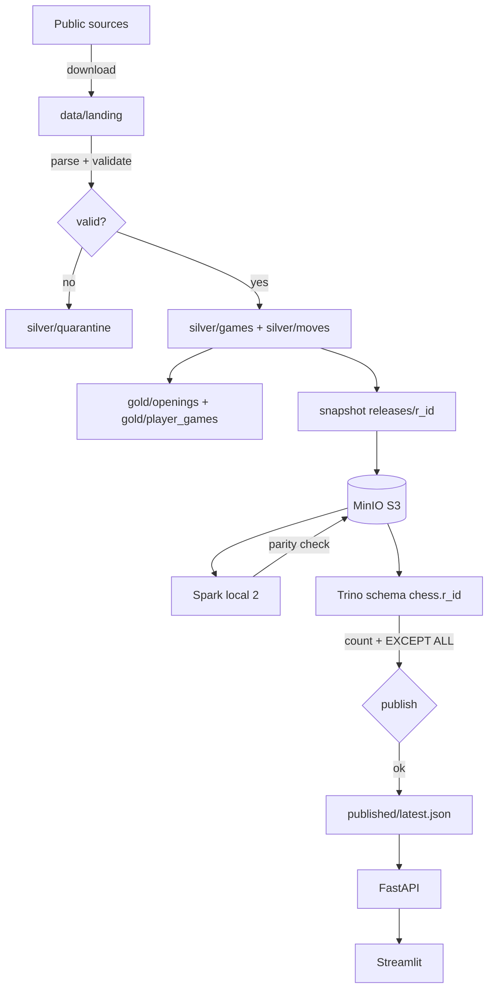

# Architecture and invariants

This document explains how chess4f fits together, which guarantees are actually
enforced, and where the boundaries are. It complements the runbook pages
([lakehouse](LAKEHOUSE.md), [orchestration](ORCHESTRATION.md), [user jobs](USER_JOBS.md),
[data contract](DATA_CONTRACT.md)).

## Goals and non-goals

**Goals.** A local, reproducible chess analytics application whose numbers can be
traced back to source objects, whose published release is validated by two engines,
and whose sample limits are visible instead of implied.

**Non-goals.** Multi-node Spark, public multi-tenant serving, real-time engine
analysis, or complete historical coverage. The demo runs on one Windows machine
with 16 GB RAM.

## Components

| Layer | Component | Responsibility |
|---|---|---|
| Source | `sources.py` | Lichess monthly `.zst` stream, Chess.com PubAPI, Lichess player export, finished-game PGN |
| Landing | `bronze_objects/` | Original PGN/JSONL kept by SHA-256 content hash |
| Transform | `pipeline.py` + `openings.py` | PGN validation, quarantine, stable game IDs, position-based opening recognition, Delta writes |
| Local store | `storage.py` | Six Delta tables, MERGE upserts, DuckDB views over active Delta files |
| Publication | `lakehouse.py` | Immutable snapshot, S3 upload, Trino registration, parity validation, pointer switch |
| Compute | `jobs/build_gold.py` | Spark `local[2]` recomputation of Gold, bidirectional parity with local Gold |
| Serving | `trino_serving.py` + `api.py` | Fixed SQL through Trino, release pinned per request |
| UI | `apps/` | Streamlit analytics, replay, live observer, sync forms |
| Orchestration | `definitions.py` + `requests_queue.py` | Schedules, request sensor, per-month progress, retry |

## Data flow

Two passes over Gold exist on purpose. The local DuckDB pass is the fast,
developer-visible aggregate. Spark recomputes the same aggregates independently
on S3, and publication requires full multiset equality in both directions. The
parity check is what makes a "Spark pipeline" claim meaningful rather than
decorative.

## Enforced invariants

| Invariant | Enforcement |
|---|---|
| One row per game | `game_key = platform:platform_game_id`, MERGE on `game_key` |
| Re-import cannot duplicate or leave an old move tail | moves for affected games are deleted before upsert; `move_key` is unique per game/ply |
| Two perspective rows per game, never a game count | `gold/player_games` built by `UNION ALL` of white and black views |
| Openings are matched by legal position, not name | `position_key` excludes clocks, keeps turn/castling/legal en passant |
| Release paths are immutable | UUID release directory; upload refuses an existing prefix; Spark writes `errorifexists` |
| A failed validation never changes serving | pointer is written last, after Trino parity |
| No silent stale/fallback reads | Trino failure maps to HTTP 503; the dashboard has no engine selector |
| One writer per data root | `pipeline.lock` file lock around ingestion and publication |
| Quantitative claims stay bounded | coverage ledger + caps recorded in run manifests |

## Failure semantics

- **Ingestion fails mid-file**: Bronze/Silver may be newer than Gold; the run
  manifest records failure, and a retry rebuilds Gold. Multi-table ingestion is
  not one global transaction.
- **Spark fails**: the release stays `exported/uploaded`; the serving pointer is
  untouched. Recovery allocates a **new** release instead of overwriting.
- **Trino validation fails**: same as above; the failure is logged and the
  previous release continues serving.
- **API restarts**: queued request files are durable on disk; live observers are
  in-memory threads and must be reconnected explicitly.
- **Dagster run interrupted**: the sensor marks the request failed only when the
  Dagster run is finished and unsuccessful; retry reuses completed months.

## Concurrency model

- Local pipeline and publication are serialized by file locks.
- Dagster runs an in-process executor with one queued run at a time.
- The request sensor polls every 15 seconds and starts at most one job per request.
- At most two live observers run per API process, each bounded to six hours.

Dagster and Docker Compose are separate lifecycles: Compose can be up while
Dagster is stopped, in which case requests wait in `waiting_for_dagster`.

## Why DuckDB remains internal

DuckDB is the transformation, training and reference engine: it reads the active
Delta file list, computes Gold and supplies the comparison values in verification
scripts. Application analytics are served only by Trino over a published release.
Keeping the two roles separate is deliberate: it avoids pretending the local
engine is the serving system, and it gives an independent implementation to
compare against.

## Scaling path (not implemented)

1. Partition Silver and Gold by `year_month`, then refresh only affected
   partitions instead of rewriting whole aggregate tables.
2. Replace full snapshot export with incremental release manifests.
3. Schedule compaction/retention with explicit snapshot retention.
4. Migrate the metastore from embedded Derby to PostgreSQL for concurrent use.
5. Add authentication and per-user quotas before exposing write endpoints.

These are roadmap items, not current capabilities.

## Verification map

| Question | Check |
|---|---|
| Does serving match local data? | `scripts/verify-serving.py` |
| Do all opening views work? | `scripts/verify-openings.py` |
| Is Spark/Trino parity enforced? | `jobs/build_gold.py`, `lakehouse.validate_publish` |
| Are invariants covered by tests? | `pytest -q` (39 tests) |
| What does the sample actually contain? | `chess4f coverage` |
