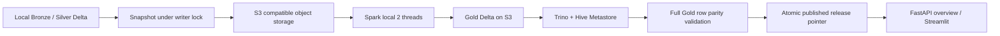

# Lakehouse integration

## Data flow



Spark reads Silver Delta on S3 and independently computes both opening aggregates and player-game perspectives. It checks full row/multiplicity equality against the frozen local Gold tables. Trino then reads the actual Spark outputs through its Delta connector and repeats bidirectional `EXCEPT ALL`, also checking source table counts. Only then does the publisher switch `published/latest.json`.

Each release has a UUID path and a separate Trino schema. The API pins one release per overview request. This provides coherent serving snapshots, not cross-table Delta transactions. A failed compute/validation leaves the previous pointer untouched. The S3 and local pointer copies are not one transaction: the local pointer is the serving authority for this local API; a crash between their writes requires rerunning publication.

The Python parser still handles PGN cleansing and position recognition. Spark currently computes Gold from already-clean Silver; do not describe this as Spark performing all ETL or as a multi-node Spark cluster. This profile deliberately uses `local[2]` on the 16 GB laptop. Full snapshot export holds Arrow tables in memory one table at a time and is intended for the bounded demo; partition/incremental publication remains future work.

## Components and ports

| Component | Version | Host access | Memory limit |
|---|---|---|---|
| MinIO | source release 2025-10-15 | API 19000, console 19001 | 768 MB |
| Hive metastore | Apache Hive 4.0.0 / Derby | internal only | 1 GB |
| Spark | Apache Spark 3.5.0, Delta 3.0.0, Hadoop AWS 3.3.4 | batch only | 3 GB |
| Trino | 484 | 18090 | 2300 MB |

Ports bind to 127.0.0.1. Separate Compose project `chess4f-lake` does not reuse other projects' volumes or credentials. MinIO files live under `data/object-store`; Derby metadata uses the `chess4f-lake_metastore` Docker volume. Back up both. Do not run `down -v` if retaining the catalog. The metastore uses embedded Derby for this single-instance local deployment; PostgreSQL migration is a separate production concern.

MinIO is built from the official source release because the old registry image is unavailable. The build recipe is in `infra/minio/Dockerfile`. Credentials are generated once into ignored `.env.lakehouse`; no passwords are stored in Git. This local demo uses one storage credential for the services; production requires separate policies, TLS and authentication.

## Run on Windows

First import source data using the main README. From the repository root:

```powershell
.\.venv\Scripts\python.exe -m pip install -e '.[dev,lakehouse]'
.\scripts\run-lakehouse.ps1 -Build
```

Subsequent releases omit `-Build`. The script stops only chess4f's Trino before Spark, then restarts it for validation. It does not stop other projects. Container limits are ceilings, not a promise of available memory; close unrelated heavy jobs if needed.

Start/rebuild the main API and dashboard after source updates:

```powershell
docker compose up --build -d api dashboard
```

On the overview page choose `Query engine = trino`. The displayed release ID ties the chart to validated Spark outputs. Other pages still use the local DuckDB store in this milestone. Switching back to DuckDB displays current local data, which can be newer than the last published S3 release.

Inspect a release:

```powershell
Get-Content data/published/latest.json
docker compose --env-file .env.lakehouse -f compose.lakehouse.yaml ps
```

Recovery: export a new release after failed upload/compute; never overwrite a partially built release. Failed Trino registration/validation can be retried using `python -m chess4f.lakehouse publish --release r_...` once the cause is fixed. Old releases are retained; garbage collection is not automated yet.

## Upstream references

- [Trino Delta connector and register_table](https://trino.io/docs/current/connector/delta-lake.html)
- [Trino native S3 configuration](https://trino.io/docs/current/object-storage/file-system-s3.html)
- [Hive Docker metastore](https://hive.apache.org/development/quickstart/)
- [Delta/Spark compatibility](https://docs.delta.io/releases/)
- [MinIO source releases](https://github.com/minio/minio/releases)

See VALIDATION.md for executed checks. Configuration files alone are not deployment evidence.

## Serving verification

With an unchanged local dataset and its published snapshot, run:

```powershell
.\.venv\Scripts\python.exe scripts/verify-serving.py
```

The check compares DuckDB and Trino counts and every opening aggregate for all three supported sources, then uses Streamlit AppTest to change the query engine and verify the displayed metrics and release caption. It requires running API, S3, Hive and Trino services; it is not part of isolated unit CI. Differences are expected if the local dataset was updated after publication: publish a new release before comparing.

Hive uses the Hadoop 3.3.6 S3A libraries bundled with its image. Credentials come from environment variables. On restart it checks the Derby schema, not just whether its directory exists. An incomplete catalog stops with an explicit error; preserve its directory before recovery. Do not delete the Docker volume to fix a startup error.

To reopen an already-built demo without collecting or rebuilding data, run `.\scripts\start-demo.ps1`. It waits for a successful Trino-backed API query before starting the dashboard. Build the images first as described above. Cold Docker starts may take several minutes on this machine.
